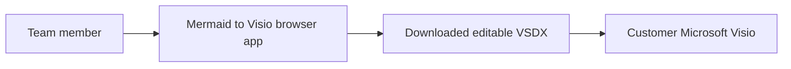
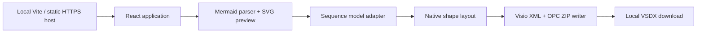

# Mermaid to Visio: Delivery Plan

## Goal

Paste AI-generated Mermaid sequence code, inspect a preview, and download a
`.vsdx` file containing native editable Visio shapes, text, and connectors.
The provided CreateBillRequest sequence is the primary acceptance fixture.
No diagram content is uploaded, persisted automatically, or sent to an AI service.

## Scope

Current release: participants and actors, solid/dashed/open/cross messages,
self-messages, multiline labels, explicit activations, and nested alt/else, opt,
loop and par/and frames. All use the reference's 12 UML Sequence masters. Notes
and cross marks are plain shapes, because the reference has no master for them.
`par` uses the Alternative fragment with a `par` tag. Unsupported constructs
(box, create/destroy, autonumber, rect, critical, break, metadata, directives)
fail explicitly instead of being approximated. Other Mermaid diagram families
remain out of scope apart from ER diagrams (below).
The preview is Mermaid-rendered; exported layout is independently computed and
is not a pixel-identical reproduction of the preview.

## Architecture

## Alternatives Considered

1. Embed Mermaid SVG in Visio: high visual fidelity but not editable diagram
   objects. Rejected because editability is the controlling requirement.
2. Automate installed Visio or use a licensed conversion SDK on a server:
   potentially stronger compatibility, but adds Windows/licensing/operations
   requirements and uploads customer diagrams.
3. Generate native VSDX in the browser: chosen for local privacy, straightforward
   team hosting, and no requirement to install Visio on the conversion machine.
   Visio desktop compatibility must be verified before customer delivery.

## Work Packages

1. Foundation: React + TypeScript + Vite, Node 22+, dependencies, build check.
2. Conversion specialist: Mermaid adapter, layout, native XML/ZIP writer,
   sample fixture, focused package/content/geometry tests.
3. Frontend specialist: responsive editor/preview, explicit validation,
   file import, filename, VSDX/source downloads, loading/error states.
4. Integration and verification: parser failures, unsupported syntax, stale
   previews, source privacy, mobile/desktop workflows, build/lint, security audit.
5. Handover: local startup scripts, static deployment instructions, limitations,
   and a generated acceptance file for testing in Microsoft Visio.

## Acceptance Gates

- The exact sample parses with 7 participants and both nested alt blocks.
- Export contains native shapes and text; no embedded raster/SVG substitute.
- Messages, self-message paths, multiline labels, frames and dividers survive.
- Export package XML is well-formed, relationships resolve, connector references
  point to existing native shapes, and page dimensions contain all objects.
- Invalid Mermaid or unsupported constructs produce actionable errors.
- Editing source during parsing/export cannot download a stale preview/model.
- Browser workflow and download work at desktop and mobile sizes.
- Production build, focused tests, and lint pass.
- Open the generated sample in Microsoft Visio, confirm no repair dialog, edit
  a label, move a participant, and save/reopen. Automated ZIP/XML tests alone
  cannot establish this gate; document it as unverified if Visio is unavailable.

## Team Access Later

Deploy the production static assets behind HTTPS on Azure Static Web Apps,
Cloudflare Pages, an approved internal server, or equivalent. Prefer an
identity-protected team site even though conversion stays local. Public hosting
does not make customer diagrams public; avoid analytics/source logging.
Do not expose the Vite development server to the internet.

## Agent / Model Constraint

Implementation/review work was invoked as separate Claude Opus 5.5 sessions by
the host. Predefined Orchestrator tool restrictions require host-mediated
delegation; sessions could not call nested agents themselves. No "High"
reasoning knob was exposed. For the final pass the host ran two parallel
independent Opus sessions: this delivery cleanup (README, PLAN, samples) and a
read-only engine review. The cleanup session did not review its own engine work.

## Verification Outcome

- Latest results: 51 converter tests, 9 Edge workflows, lint, `tsc -b` and
  `vite build` all pass. The earlier npm audit had zero findings, and
  dependencies are unchanged since.
- The sample has 7 participants, 21 messages, 7 Activations, 2 nested
  Alternative fragments with 4 operands, and 56 Connects.
- Visio 16 COM confirmed: 12 masters identical by UniqueID, styles and snap
  match, 2,415 cached position/size/connection values match (text measurement
  is approximate, not claimed identical), and 56/56 endpoints stayed glued after an
  API lifeline move and after save/reopen. Dropping the original masters added
  no duplicates.
- Open manual gate: mouse-drag Activation endpoints and bar body, and drag
  message endpoints, in the Visio UI.
- Public deployment, other diagram families, and other Visio versions are
  outside this release's verified scope.

## Release Gates

| Gate | Status |
| --- | --- |
| 51 converter tests, 9 Edge workflows, lint, `tsc -b`, `vite build` | Passed |
| npm audit (dependencies unchanged since) | Zero findings |
| Visio 16 COM: 12 masters, styles, snap, 2,415 cached geometry values | Passed |
| Visio 16 COM probes: native self-message Asynchronous toggle; idle and after-`end` lifetimes | Passed |
| Visio 16 COM: 56/56 glue after API lifeline move and save/reopen | Passed |
| Current sample images (page, Activation, Self Message) | Regenerated from current sample |
| Research extracts of the original removed from `samples/` | Done |
| Original reference SHA256 `FA5366E4...9CF4FD7` unchanged | Verified |
| Manual mouse/UI Visio test (README "Manual release gate") | **Pending** |
| Other Visio versions, Visio for the web, public hosting | Out of scope |

The release is not customer-ready until the manual UI gate passes.

## Unified Theme Decision

The original reference's Parallel theme XML is embedded unchanged. Shared
tokens contain measured shape colors, fonts and dimensions. All diagrams use
the selected 21.5 x 24.5 inch screenshot page and reference print/layout/layer
settings. This intentionally overrides the source file's 16.5-inch height and
8-inch Y origins. Lifetimes require explicit Mermaid activation instructions.
Content-aware spacing avoids clipped text and intersecting frame dividers.
Text is never scaled down. Oversized diagrams fail with a split message once
they exceed the fixed page or the native connection-point range.
Palette consistency does not make Mermaid's preview layout pixel-identical to
the native Visio layout or make new content match hand-positioned reference coordinates.

## Native Editing Correction

Activations use the original Activation master: a 1D shape with Begin at the
bottom and End at the top, and 100 cached connection points. Each bar runs
from its opening message to its explicit deactivation marker: a direct
`-->>-` closes at that return, an idle `deactivate` honours the other
participants' later messages, and a `deactivate` after `end` closes below the
frame footer. The master's 100 points cover 47 levels on the left edge and 49
on the right; longer bars get instance-only appended Connection rows (IX 100+)
only where a point is missing, and the master stays byte-identical. Self-message
heads follow the master's `User.IsAsync` rule so the Asynchronous action
works; dashed self-messages add only a local dash. Self labels start at the
loop's outer edge, use the master's text margin, and are vertically centred.
Visio COM confirmed glue only after a lifeline move, not after bar or endpoint
edits. Mouse-dragging bars and endpoints remains a manual review gate.
## ER Diagram Export

Goal: AI-generated Mermaid `erDiagram` source becomes the team's classic Visio
Database Model Diagram (Entity Relationship stencil, Relational crow's-foot
notation), matching the look of the team's reference ERD.

Decisions (with the solution architect, 2026-10-14):
- Masters, styles and the page's database settings come from the shared
  reference ERD (SHA256 `A0FD84EB...87FAD6D`), extracted by
  `scripts/extract-erd-template.mjs`. The add-on's Database Model master embeds
  the customer schema as an OLE object and is never shipped; neither are the
  reference pages, docProps or thumbnail.
- `NOT NULL` is a column comment keyword; PK columns are always bold.
- The reference's red/green/orange change marks are tracking-only and are not
  generated; every column exports as a plain row.
- Views are explicit (`:::view`), never inferred from names.
- Many-to-many relationships are rejected (physical ERDs need an associative table).
- Generated entities are free-form (no model reference): the master's own
  `ManualEdits` rule makes them text-editable and keeps the add-on out; the
  add-on's document-open events are removed so opening a file never asks it to
  find the missing model.

Verification:
- 23 ER unit tests: parser mapping/rejections, byte-identical masters, no
  model/OLE/events/customer strings, native text/tab stops/PK separator,
  crow's-foot ends and dash patterns from the master formulas, whole-shape glue
  on entity edges, orthogonal paths, no table overlaps and no relationship
  crossing an unrelated table (sample, a 20-table schema, LR direction).
- Round trip of the reference schema (local only, not committed): 21 tables and
  views, 12 relationships, 24 connects; heights and line counts identical,
  widths within 0.1 in, tab stops within 0.09 in.
- **Pending:** the README's manual Visio gate. Visio was not available, so
  no repair-free open, editing or glue behaviour has been observed in Visio.

### Model-backed tables (ERX)

Opening the `.vsdx` export showed free-form tables: the template's shapes, but no
Database tab, Database Properties or model. The add-on's model is a proprietary
InfoModeler/ORM binary (MFC-serialised `ORMInfo`/`MAPInfo` streams plus a
shape-GUID map), so generating it was rejected as unverifiable. Reverse
engineering from SQL Server was rejected because it requires a database
installation. Chosen: an ERwin 3.5 `.erx` export, which Visio Professional
2016-2024 imports natively (Database > Import), producing real model tables
that designers edit in Database Properties. The format follows an
ERwin-written ERX 3.5 file (section order, codes, built-in domains). Pending:
the first import in the team's Visio, including data type mapping and the
`CT_EX` (exactly one) cardinality code, which the reference file did not use.
