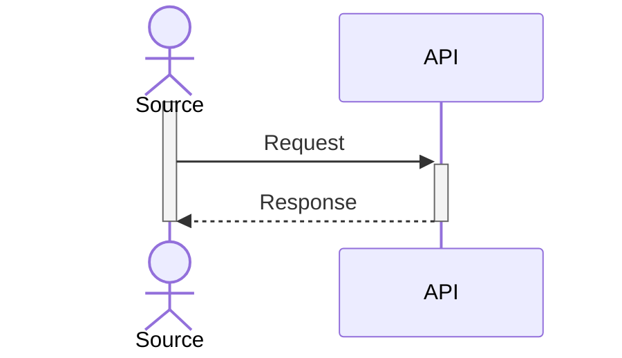
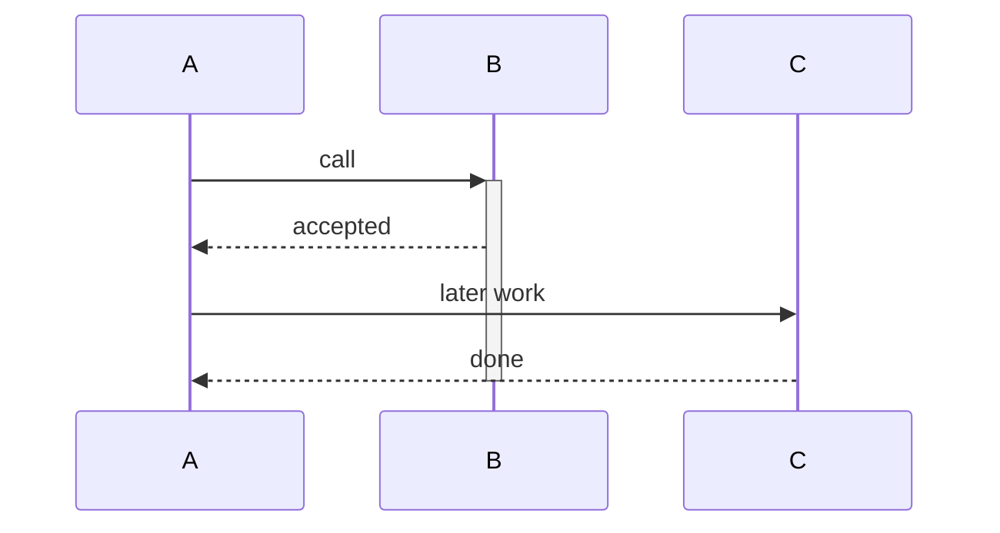

# Mermaid to Visio

A local-first team workspace converting Mermaid sequence diagrams into native,
editable Microsoft Visio `.vsdx` files. Visio is not required for conversion;
Microsoft Visio is required to edit downloaded files in Visio.

## Run Locally

On this machine, double-click `Start-Local.cmd` in the application folder.
It uses an isolated Node 22 runtime, starts a localhost-only server, and opens
the browser. The first runtime download needs internet; subsequent starts
can reuse npm's cache. Keep the terminal open; stop with Ctrl+C.
If port 5173 is occupied, Vite selects another port and prints the URL.

For a new machine, install Node 22.12+ and run:

```powershell
npm ci
npm run dev -- --host 127.0.0.1
```

Paste source or import `.mmd`/`.txt`, name the diagram, select **Prepare
preview**, then **Download Visio**. Editing source invalidates export until
prepared again. Source can also be downloaded as `.mmd`.

## Supported Syntax

Every exported object uses one of the 12 UML Sequence masters copied byte-for-byte
from the reference drawing (SHA256s in `src/converter/native/manifest.json`),
except where the table says **plain shape**.

| Mermaid | Visio export |
| --- | --- |
| `participant` / `actor` | Object lifeline / Actor lifeline master |
| `->>`, `->`, `-x` (solid) | Message master |
| `-)` (solid open) | Asynchronous Message master |
| any dashed `-->>`, `-->`, `--x`, `--)` | Return Message master (dashed, open head) |
| `A->>A` self-message | Self Message master; head from its native `User.IsAsync` rule (see below) |
| `-x` / `--x` cross | arrowhead off + **plain shape** X pinned to `EndX/EndY` |
| `activate`/`deactivate`, `+`/`-` | Activation master |
| `alt`/`else` | Alternative fragment + Interaction operands |
| `par`/`and` | Alternative fragment with tag text `par` + operands |
| `loop`, `opt` | Loop fragment, Optional fragment |
| `Note left/right/over` | **plain shape** rectangle; the reference has no note master |

The Other fragment master is packaged but not used. `<br/>` gives multiline labels.
Frames nest up to 8 levels.

The following are explicitly rejected, never approximated: `box`, `create`/`destroy`,
`autonumber`, `title`/`accTitle`/`accDescr`, links/properties/details, `rect`,
`critical`, `break`, central-connection and other unknown event types,
`%%{}` directives, frontmatter, `@{}` metadata, HTML other than `<br/>`, and
other diagram families.
Limits: 100,000 source characters, 100 KB imported files, 1-30 participants,
1,000 sequence events and 500 messages.

## Editability And Layout

No SVG/image substitutes are used. Each object keeps its master's shape data,
Actions and controls (for example Message / Return Message / Asynchronous toggles
and the lifeline length control). Every message endpoint is glued with
`PAR(PNT(...))` to a native connection point. The point is on the deepest active bar,
or on the lifeline if no bar is active. Root activations are glued to
lifeline points. Nested activations are glued to the parent bar's side points.
Alternative fragments are real containers. Their operands, and nested
fragments, are container members.
Containers paint behind the lifelines. Operands paint above the activation bars,
so guard text (on a white text-only background) is never covered.

Activations use the original Activation master as a 1D shape. Begin is at the
bottom and End at the top, like the reference instances. All 100 inherited
connection points, and any appended instance points (see below), have
precomputed cached values. Self-message loops are 0.25 in wide and
0.5 in tall. The label's text block starts at the loop's outer edge and keeps
the master's own text margin. It is vertically centred on the loop.

Self-message heads use the master's own `EndArrow` formula
`IF(OR(User.IsReturn,User.IsAsync),3,4)`; no `EndArrow` override is written.
`A->>A` keeps `User.IsAsync = 0` (filled). `A-)A`, `A-->>A` and `A--)A` set
`User.IsAsync = 1` (open), so the right-click **Asynchronous** action toggles
the head natively. Dashed self-messages add only a local `LinePattern` dash:
the native `User.IsReturn` flag would also clear `User.IsSelfMessage` and hide
the loop geometry. `-x`/`--x` and `-`/`--` keep `EndArrow = GUARD(0)`.

## Unified Reference Theme

Every export embeds the reference's Parallel theme XML (index 40), its document
settings, and its style sheets. Font table: Calibri, Arial. Snap settings: 65847.
The reference drawing is not modified or needed at runtime.
Shared tokens in `src/converter/theme.ts` define the palette and dimensions.
Only whole-word success/failure guards are colored green/red.

Page size is fixed at **21.5 x 24.5 inches**, with 0.25-inch margins and a
quarter-inch grid. Other page settings: 1:1 scale, the reference layout/ruler
settings, and a Connector layer. (The original file is 16.5 inches tall; the
selected screenshot overrides that.) Text is never scaled down. Labels wrap at
the participant spacing. Layout follows the native quarter-inch (`PITCH`)
connection grid in `src/converter/vsdx.ts`. Export fails with a "split the diagram"
message if any of these happens:

- Participants cannot be compressed to fit 21.5 in (about 18+ participants).
- The lifeline needs more than its 100 native points (99 quarter-inch levels).
- A nested activation has no matching parent connection point.

Activation length is bounded only by the page/lifeline limit above. The
embedded Activation master stays byte-identical, including its 100 Connection
rows: right-edge points reach 49 levels (12.25 in) from the top, left-edge
points 47 levels (11.75 in), because rows 91-99 reuse earlier positions. That
is a template point range, not a bar length limit (a dropped original master
stretches freely in Visio). When a message or nested bar needs a point the 100
rows lack, the converter appends a row to that **instance's** Connection
section only (IX 100+, quarter-inch pitch, glued as `ToPart` 200+). Appended
rows are local, not inherited: X `IF(Width>=dIN,Width-dIN,Width)` (the master's
own even-row rule) and Y copied from a master row on the same edge
(`Height*0` right, `Height*1` left), with cached values. Existing points are
always reused first; nothing is appended when they suffice.

Activation lifetimes must be explicit in Mermaid; they are never guessed:



`activate`/`deactivate` and `->>+`/`-->>-` are supported. Unbalanced activations
are rejected. When an activation spans an `alt` block, close it after the block.
Without activation statements, no bars are drawn.

Bar policy: the top is the message that opened the activation, or else the
participant's first message inside it. The bottom is the explicit deactivation
marker's position, never earlier than the participant's last message:

- `-->>-` (or `deactivate` straight after a message) ends at that message's arrow.
- A `deactivate` after other participants' messages ends at the last of those
  messages; idle time is part of the lifetime.
- A `deactivate` after a frame's `end` ends just below the frame footer.

In this example B's bar runs from `call` to `done`, not to `accepted`; the
converter tests cover this idle case and the after-`end` case:



If B's work really ends at `accepted`, deactivate B there. An activation with
no messages is one quarter inch long.

The browser preview shares the palette but uses Mermaid's layout. Visio layout
uses the unified native-shape standard; arbitrary diagrams are not pixel copies
of the hand-positioned reference. Review downloads before customer delivery,
especially long labels, Arabic/bilingual text, and printing.

## Privacy And Hosting

Parsing and conversion run in the browser: no AI calls, diagram uploads,
analytics, automatic source persistence or external fonts. Reloading discards
unsaved source. Input is restricted and SVG/CSS filtered before display.

```powershell
npm run build
```

Deploy **the contents of `dist`** to Azure Static Web Apps, Cloudflare Pages,
or an approved internal HTTPS server. The app targets the site root; configure
Vite `base` and rebuild for subpath hosting. Prefer an identity-protected team
site; authentication is not implemented in this local release. Do not publish
the source folder or expose Vite dev/preview servers publicly. Disable diagram
logging and third-party analytics. Public deployment has not been performed.

Research extracts of the original drawing have been removed from `samples/`.
The embedded native assets contain no docProps, thumbnail, customXml, user
names or e-mail addresses. Ship only the contents of `dist` (plus this README
and the generated sample if wanted); never ship the original reference drawing,
`node_modules`, test reports or the source folder.

## Verification

```powershell
npm test
npm run lint
npm run build
$env:PLAYWRIGHT_START_SERVER = '1'
npm run test:e2e
```

Browser tests use installed Edge and start/reuse a localhost server. They cover
native downloads, imports, invalid input, stale-operation races, line styling,
nonblank images, and desktop/mobile layouts. Mermaid is pinned because its
sequence DB is version-specific. KaTeX is overridden to patched 0.18.2;
rerun tests when updating these dependencies.

Latest results (Node 22.23): 51 converter tests, 9 Edge workflows, lint,
`tsc -b` and `vite build` all pass. No dependencies have changed since the
earlier zero-finding audit.

The sample `samples/CreateBillRequest.vsdx` contains:

- 7 participants (1 Actor lifeline, 6 Object lifelines)
- 21 messages: 6 Message, 7 Self Message, 8 Return Message
- 7 Activations (Source, IAG and SR are deactivated after the outer `alt`, so
  their bars end just below its footer)
- 2 nested Alternative fragments with 4 operands
- 56 Connects

The Visio 16 COM check (`samples/CreateBillRequest.verification.json`) confirmed:

- `failures: []`
- All 12 masters match the original masters' UniqueIDs. Style sheets and snap
  settings (65847) also match.
- Dropping every original master reused the embedded ones: 12 masters, no
  duplicates.
- 2,415 cached position, size, angle, Begin/End and connection-point values
  match Visio's own recalculation. Text/font measurement is approximate and is
  not claimed identical; Visio recalculates it. Unsupported formulas fall back
  to the master cache only for non-geometry cells; a placement, size or
  connection formula the engine cannot evaluate fails the export.
- Activation orientation and container membership are correct.
- 56/56 endpoints stayed glued after a lifeline move done through the API, and
  again after save and reopen.
- Separate TEMP COM probes: `A->>A`, `A-)A`, `A-->>A`, `A--)A` all inherit the
  original `EndArrow` formula; triggering the Asynchronous action flips
  `User.IsAsync` and the head (4<->3) both ways, and the loop stays visible.
  `A-xA` keeps `GUARD(0)`. The idle and after-`end` lifetime cases render
  glued with the bar bottoms described above. First interaction operands carry
  the `LISTORDER()`-derived hidden divider (`NoShow = 1`) in their cache.

`samples/CreateBillRequest.png` and `samples/Activation-detail.png` are
Visio-rendered from the same run. `samples/SelfMessage-detail.png` is a Visio 16
`Shape.Export` of the current sample's native Self Message (`Message.15`,
"12. Create bill and timeline entry"), taken from a read-only TEMP copy; the
lifetime/async fix does not change that filled self-message or the Billing bar.

**Manual release gate (pending; not customer-ready until passed).** The COM
check moves a lifeline through the API only; no mouse/UI edit has been verified.
In Visio desktop, open a TEMP copy of `samples/CreateBillRequest.vsdx` and:

1. Confirm no repair dialog appears.
2. Select an Activation bar; drag its top handle, then its bottom handle. The
   attached message endpoints must stay glued.
3. Drag the bar body along its lifeline; it must remain glued and keep its
   messages attached.
4. Detach a message endpoint, then re-glue it to a bar or lifeline point.
5. Right-click a lifeline: the native Actions (for example Show Actor /
   Show Destruction) must work.
6. Resize an Alternative fragment; operands and the nested fragment must stay
   members. Drop a new shape inside and confirm it becomes a member.
7. Drag a Self Message text control; the label must move natively.
8. Save, close, reopen; repeat steps 2 and 4 and confirm glue persists.

Record the Visio version, result and tester for each step. Other Visio versions
and Visio for the web are not certified. The export is a structural
native-fidelity match, not a pixel copy of the hand-drawn reference.

Regenerate the sample and repeat the optional Windows/Visio COM check:

```powershell
$env:WRITE_SAMPLE = '1'
npm test -- src/converter/vsdx.test.ts
Remove-Item Env:WRITE_SAMPLE
& ./src/converter/verify-visio.ps1 -OriginalPath 'path/to/reference.vsdx'
```

The COM check needs Windows and installed Visio (browser conversion does not).
It opens the reference read-only (it is SHA-guarded) and edits only TEMP
copies. `-OriginalPath` (or `$env:M2V_REFERENCE_VSDX`) is required; there is no
default path. Architecture and scope decisions are in `PLAN.md`.
On machines with slow default Vitest workers, append
`--pool=forks --maxWorkers=1 --no-file-parallelism` to the test command.
